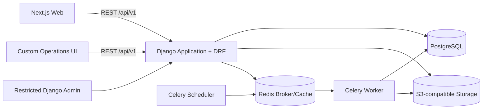

# طرح معماری بک‌اند Django
وضعیت: `Accepted`

## خلاصهٔ تصمیم
بک‌اند MVP طبق ADR-0003 پذیرفته‌شده به‌صورت **مونولیت ماژولار Django** با API مبتنی بر REST ساخته می‌شود. PostgreSQL منبع اصلی و قطعی داده است. کارهای زمان‌دار و پس‌زمینه با Celery و یک broker جدا اجرا می‌شوند، اما deadlineها و وضعیت گردش‌ها همیشه در PostgreSQL باقی می‌مانند. فایل‌ها در object storage سازگار با S3 نگهداری می‌شوند.

این طرح عمداً از microservice و زیرساخت توزیع‌شدهٔ زودهنگام پرهیز می‌کند؛ مرز ماژول‌ها طوری تعریف می‌شود که جداسازی آینده ممکن بماند.

## محرک‌های معماری
- تراکنش‌های قوی میان سفارش، رزرو، قیمت تثبیت‌شده، کارمزد و تسویه لازم‌اند.

- تقریباً همهٔ عملیات حساس باید actor، زمان، دلیل و قبل/بعد قابل‌ردیابی داشته باشند.

- سه محور دسترسی کاربر، نوع کسب‌وکار و نقش عضویت نباید در یک role مخلوط شوند.

- گردش‌ها deadlineهای ۲۴ساعته، ۴۸ساعته، ۷۲ساعته و ۱۴روزه دارند.

- MVP کنترل‌شده و غیرواقعی است، ولی دادهٔ آن نباید بعدها با معاملهٔ واقعی اشتباه شود.

- Next.js مصرف‌کنندهٔ اصلی API است و قرارداد باید قبل از پیاده‌سازی UI تثبیت شود.

- سادگی عملیاتی برای تیم اولیه از scale فرضی مهم‌تر است.

## پشتهٔ فنی و وضعیت تصمیم‌ها
| بخش | پیشنهاد | وضعیت/دلیل |
| --- | --- | --- |
| زبان | Python 3.13، آخرین patch | Accepted؛ خط مبنای پایدار و تحت پشتیبانی Django 5.2 |
| framework | Django 5.2 LTS، آخرین patch | Accepted؛ نسخهٔ LTS مناسب عمر MVP تا پایلوت |
| API | Django REST Framework، REST JSON، `/api/v1/` | Accepted طبق ADR-0008؛ قرارداد روشن و نسخه‌دار برای Next.js |
| دیتابیس | PostgreSQL، نسخهٔ دقیق پس از انتخاب hosting | Accepted طبق ADR-0004؛ روابط و تراکنش‌های دامنه، constraint و JSONB در نقاط محدود |
| کار پس‌زمینه | Celery + scheduler؛ Redis به‌عنوان broker/cache | Accepted طبق ADR-0009؛ expiry، release reservation و اعلان‌ها؛ PostgreSQL منبع حقیقت می‌ماند |
| فایل | S3-compatible object storage خصوصی با URL امضاشده | Accepted طبق ADR-0006؛ تصاویر محصول، مدارک و پیوست‌ها خارج از filesystem اپ |
| قرارداد API | OpenAPI 3 و contract test | Accepted طبق ADR-0008؛ هماهنگی backend/Next.js و تشخیص drift در CI |
| اجرا | container برای web، worker و scheduler | Accepted طبق ADR-0007؛ محیط‌های توسعه، staging و production هم‌شکل |

خانوادهٔ نسخه‌های Python 3.13 و Django 5.2 پذیرفته شده‌اند؛ شمارهٔ patch دقیق و سایر dependencyها هنگام scaffold در lockfile قفل می‌شوند. Django 5.2 یک نسخهٔ LTS است، PostgreSQL 14 به بالا را پشتیبانی می‌کند و نسخه‌های فعلی DRF نیز Django 5.2 را پشتیبانی می‌کنند. منابع: [Django 5.2 release notes](https://docs.djangoproject.com/en/5.2/releases/5.2/)، [Django database support](https://docs.djangoproject.com/en/5.2/ref/databases/)، [DRF requirements](https://www.django-rest-framework.org/)، [Celery with Django](https://docs.celeryq.dev/en/stable/django/first-steps-with-django.html).

## نمای اجزا



## مرز ماژول‌های دامنه
مرزهای منطقی ریزتر از Django app هستند. برای MVP چند مفهوم نزدیک در یک app نگه داشته می‌شوند و داخل آن submodule دارند؛ اگر اندازه یا ownership واقعی رشد کرد، آن‌گاه app جدا می‌شود.

| Django app | مسئولیت | نباید مالک چه چیزی باشد |
| --- | --- | --- |
| `common` | base model، شناسه/زمان، خطاها و primitives عمومی | منطق کسب‌وکار دامنه‌ها |
| `accounts` | User، Business، Membership، نقش‌ها، تأیید و تعلیق | دادهٔ محصول یا سفارش |
| `catalog` | دسته، ویژگی، محصول، تنوع، تصویر، قیمت، عرضه و انتشار | snapshot و چرخهٔ سفارش |
| `orders` | سبد، گروه سفارش، سفارش، اقلام، snapshot و state transition | تراکنش واقعی بانکی |
| `finance` | payment event، invoice، commission، refund و settlement شبیه‌سازی‌شده | کاتالوگ زنده |
| `fulfillment` | آماده‌سازی، روش حمل، مرسوله، اقلام، tracking و کد تحویل | عملیات واقعی حمل |
| `disputes` | پرونده/ردیف مغایرت، پاسخ، تصمیم و جبران | پیام‌های عمومی پشتیبانی |
| `support` | تیکت، پیام، پیوست و ارجاع | تغییر مستقیم وضعیت مالی |
| `reviews` | entitlement، review، پاسخ و moderation | بازکردن مغایرت یا تعدیل مالی |
| `operations` | صف اپراتور، audit، notification outbox و اقدامات حساس | دورزدن serviceهای دامنه |
| `analytics` | query/read model و معیارهای داشبورد | منطق write و تغییر وضعیت |

### جهت وابستگی
```text
accounts ─────────────────> orders
catalog ──────────────────> orders
orders ─> finance
orders ─> fulfillment ─> disputes ─> finance
orders/disputes ─> support
orders ─> reviews
همهٔ ماژول‌های حساس ─> operations
همهٔ read modelها ─> analytics

```
وابستگی دوری ممنوع است. تعامل متقابل با service function، domain event داخلی یا interface مشخص انجام می‌شود، نه import تصادفی مدل‌ها از هر جهت.

## ساختار پیشنهادی پروژه
```text
apps/backend/
├── pyproject.toml
├── manage.py
├── config/
│   ├── settings/
│   │   ├── base.py
│   │   ├── local.py
│   │   ├── test.py
│   │   └── production.py
│   ├── urls.py
│   ├── asgi.py
│   ├── wsgi.py
│   └── celery.py
├── marketplace/
│   ├── common/
│   ├── accounts/
│   ├── catalog/
│   ├── orders/
│   ├── finance/
│   ├── fulfillment/
│   ├── disputes/
│   ├── support/
│   ├── reviews/
│   ├── operations/
│   └── analytics/
└── tests/
    ├── integration/
    └── contract/

```
هر app فقط به اندازهٔ نیاز پوشه‌های `models/`، `api/`، `services/`، `selectors/`، `tasks.py` و `tests/` می‌گیرد. repository layer عمومی یا abstraction روی ORM تا زمانی که مسئلهٔ واقعی حل نکند اضافه نمی‌شود.

## قواعد طراحی داده
- PostgreSQL تنها منبع حقیقت تراکنشی است؛ Redis هرگز صاحب وضعیت سفارش یا deadline نیست.

- شناسهٔ داخلی UUID و شمارهٔ قابل‌نمایش سفارش/صورتحساب/تیکت جدا و یکتا باشد.

- پول در PostgreSQL به‌صورت عدد صحیح ریال ایران (`IRR`) ذخیره شود؛ نام فیلدهای API پسوند صریح `_rial` داشته باشند. رابط کاربری تومان را با تبدیل ثابت ۱ تومان به ۱۰ ریال نمایش می‌دهد و مبلغ اعشاری یا گردکردن مجاز نیست.

- قیمت، آدرس تحویل، نام محصول/SKU، پله، کارمزد و نوع اجرای مالی هنگام سفارش snapshot شوند.

- وضعیت‌ها از enum محدود و transition service عبور کنند؛ تغییر مستقیم status از serializer یا admin ممنوع باشد.

- `UniqueConstraint`، `CheckConstraint`، foreign key و index بخشی از طراحی‌اند، نه فقط validation رابط.

- عملیات رزرو، پرداخت، تسویه و تصمیم اختلاف در `transaction.atomic()` انجام شوند و در رقابت از lock/optimistic check مناسب استفاده شود.

- همهٔ زمان‌ها در DB و API به UTC، تقویم میلادی، قالب ISO 8601 و به‌صورت timezone-aware ذخیره و منتقل شوند؛ رابط کاربری آن‌ها را با منطقهٔ زمانی تهران و تقویم شمسی نمایش دهد.
- تاریخ‌های بدون ساعت در DB میلادی ذخیره شوند و deadlineها فقط از timestamp مطلق محاسبه شوند، نه از متن یا تاریخ نمایشی.

- رویدادهای MVP فیلد صریح execution mode داشته باشند تا با رویداد واقعی آینده مخلوط نشوند.

- audit trail الحاقی است؛ اصلاح تاریخچه با رویداد جبرانی انجام می‌شود.

## ظرفیت هدف اولیه

اعداد زیر پیش‌بینی فروش یا محدودیت محصول نیستند؛ مبنای sizing، pagination، index و load test نسخهٔ MVP هستند:

- ۱۰٬۰۰۰ حساب کاربری
- ۲٬۰۰۰ کسب‌وکار
- ۱۰۰٬۰۰۰ SKU
- ۱٬۰۰۰ سفارش در روز
- ۲۰۰ کاربر هم‌زمان
- رشد پنج‌برابری حجم داده و ترافیک بدون بازطراحی اساسی معماری

## API و احراز هویت
- طراحی contract-first و مسیر پایهٔ `/api/v1/`.

- پاسخ خطا شکل ثابت شامل `code`، `message`، `fields` و `request_id` دارد.

- pagination برای همهٔ collectionهای بالقوه بزرگ اجباری است.

- permission از ترکیب کاربر، نقش پلتفرمی، membership، نوع/وضعیت کسب‌وکار و ownership رکورد محاسبه می‌شود.

- طبق ADR-0005، Django مرجع هویت و مجوز و صادرکنندهٔ access/refresh JWT است؛ NextAuth لایهٔ session و BFF وب Next.js است.
- مرورگر فقط Cookie امن `HttpOnly`/`Secure`/`SameSite` را نگه می‌دارد و JWT خام در storage یا JavaScript کلاینت قرار نمی‌گیرد.
- درخواست حفاظت‌شده از BFF سمت سرور Next.js عبور می‌کند و با Bearer access token به Django می‌رسد؛ refresh چرخشی و قابل‌blacklist است.
- نقش‌ها، عضویت و وضعیت تعلیق از claim قدیمی پذیرفته نمی‌شوند و Django آن‌ها را هنگام authorization از منبع حقیقت بررسی می‌کند.
- endpointهای مبتنی بر Cookie و عملیات state-changing همچنان حفاظت CSRF و کنترل origin لازم دارند.

- idempotency key برای عملیات حساس مانند checkout گروه، پرداخت شبیه‌سازی‌شده و تأیید تحویل در نظر گرفته شود.

- OpenAPI و contract test باید در CI با تغییر endpoint به‌روز بمانند.

## deadline و کارهای پس‌زمینه
deadline روی خود رکورد با `due_at` ذخیره می‌شود. scheduler رکوردهای سررسیدشده را پیدا می‌کند و commandهای idempotent اجرا می‌کند. از countdown طولانی در broker به‌عنوان تنها مکان نگهداری زمان استفاده نمی‌شود.

کارهای اولیه:

- انقضای مهلت پاسخ تولیدکننده و پرداخت خرده‌فروش

- آزادسازی idempotent رزرو موجودی/ظرفیت

- پایان مهلت مغایرت و ایجاد تسویهٔ شبیه‌سازی‌شده

- ارجاع مغایرت بی‌پاسخ پس از ۴۸ ساعت

- انتشار هم‌زمان reviewها پس از ۱۴ روز

- پاک‌سازی/انقضای کدهای تحویل و notification outbox

## اعلان‌ها

استثنای پذیرفته‌شده در 2026-09-07: تأیید ایمیل و بازیابی حساب از SMTP طبق [ADR-0013](../architecture/adr/0013-verified-email-account-recovery.md) ارسال می‌شوند. intent پایدار بی‌secret و hash لینک در PostgreSQL نگهداری می‌شوند؛ سایر اعلان‌های دامنه همچنان از InternalInbox هستند.

- دامنه فقط intent اعلان شامل گیرنده، template key، مرجع موجودیت و payload حداقلی را در outbox پایدار ثبت می‌کند.
- ارسال از interface قابل‌تعویض provider عبور می‌کند؛ provider فعال MVP فقط `InternalInbox` است.
- `InternalInbox` اعلان را در حساب کاربر نمایش می‌دهد و هیچ SMS، ایمیل یا Push واقعی ارسال نمی‌کند.
- تولید و اعتبارسنجی کد تحویل در `fulfillment` می‌ماند؛ provider اعلان مالک secret یا وضعیت تحویل نیست.
- adapterهای SMS، ایمیل یا Push بعداً بدون تغییر commandها و state machineهای دامنه افزوده می‌شوند.
- retry و idempotency نباید یک اعلان را چندبار در یک کانال ایجاد کنند.

## تست و کیفیت
- unit test برای محاسبهٔ قیمت، کارمزد، permission و transitionها

- integration test با PostgreSQL واقعی برای constraint، transaction، lock و query

- API test برای auth، tenant isolation، validation و error contract

- contract test برای OpenAPI و کلاینت Next.js

- workflow test برای مسیرهای اصلی: سفارش آماده، تولید سفارشی، سبد چندتولیدکننده، تحویل، مغایرت و تعلیق

- property-based test برای پله‌های قیمت و invariantهای مالی در صورت پیچیده‌شدن محاسبات

- تست query count برای list/detailهای پرتردد و جلوگیری از N+1

## امنیت و مشاهده‌پذیری
- اصل حداقل دسترسی و deny-by-default

- طبق ADR-0006، فایل‌های حساس در object storage خصوصی و S3-compatible نگهداری می‌شوند؛ PostgreSQL فقط metadata و کلید object را نگه می‌دارد.

- نوع، حجم و تعداد upload طبق `file-upload-policy.md` در allowlist و مرزهای صریح محدود می‌شوند؛ بررسی signature، اسکن بدافزار در production، رمزگذاری در انتقال/سکون و URL امضاشدهٔ کوتاه‌عمر الزامی است.

- ظرفیت برنامه‌ریزی objectهای اصلی سال اول ۱ ترابایت است؛ هشدارهای ۷۰٪ و ۹۰٪ برای بازبینی هزینه و افزایش ظرفیت‌اند و هیچ حذف خودکاری ایجاد نمی‌کنند. backup جداگانه محاسبه می‌شود.

- فایل حساس حذف خودکار ندارد؛ حذف دستی با تأیید مالک سامانه، بررسی hold و audit انجام و پس از restore نیز tombstone حذف دوباره اعمال می‌شود.

- rate limit برای login، صدور/اعتبارسنجی کد تحویل و endpointهای عمومی

- structured log با `request_id`، actor، business و entity؛ بدون کد تحویل، رمز یا محتوای حساس مدرک

- metricهای نرخ/خطا/مدت API، queue lag، task failure، deadline overdue و DB latency

- health check جدا برای web، worker، PostgreSQL، Redis و object storage

- backup و restore drill برای PostgreSQL و object storage و بازاعمال tombstone فایل‌های حذف‌شده پیش از pilot

## استقرار

- طبق ADR-0007، artifactهای Next.js، Django web، Celery worker و scheduler کانتینری و مستقل از ارائه‌دهنده‌اند.
- Next.js/BFF ورودی عمومی و خاتمهٔ TLS در edge/reverse proxy است؛ Django، PostgreSQL و Redis فقط در شبکهٔ خصوصی‌اند.
- staging و production شبکه، secrets، دیتابیس، bucket و دادهٔ جدا دارند.
- PostgreSQL مدیریت‌شده ترجیح دارد؛ self-hosted فقط همراه مسئولیت صریح patch، monitoring، backup و restore مجاز است.
- backup رمزگذاری‌شده در failure domain جدا نگهداری و migration/rollback/restore پیش از پایلوت تمرین می‌شود.
- provider نهایی پیش از staging براساس دسترسی از ایران، پایداری، هزینه، محدودیت داده و امکانات عملیات انتخاب می‌شود؛ منطق دامنه به API اختصاصی provider وابسته نمی‌شود.

## وضعیت ADRهای معماری
- مونولیت ماژولار Django: پذیرفته‌شده در ADR-0003

- PostgreSQL به‌عنوان دیتابیس اصلی: پذیرفته‌شده در ADR-0004

- امنیت JWT/NextAuth: پذیرفته‌شده در ADR-0005؛ عمر دقیق توکن، الگوریتم و کلید هنگام پیاده‌سازی قفل می‌شوند

- واحد پول ذخیره‌سازی و قواعد تبدیل: پذیرفته‌شده در ADR-0011

- Celery/Redis و کارهای deadlineمحور: پذیرفته‌شده در ADR-0009

- object storage و سیاست مدارک حساس: پذیرفته‌شده در ADR-0006

- topology مستقل از provider: پذیرفته‌شده در ADR-0007؛ انتخاب provider و runbook پیش از staging انجام می‌شود

- زمان و تقویم: پذیرفته‌شده در ADR-0012

- مرز Django Admin در برابر پنل عملیات سفارشی: پذیرفته‌شده در ADR-0010
