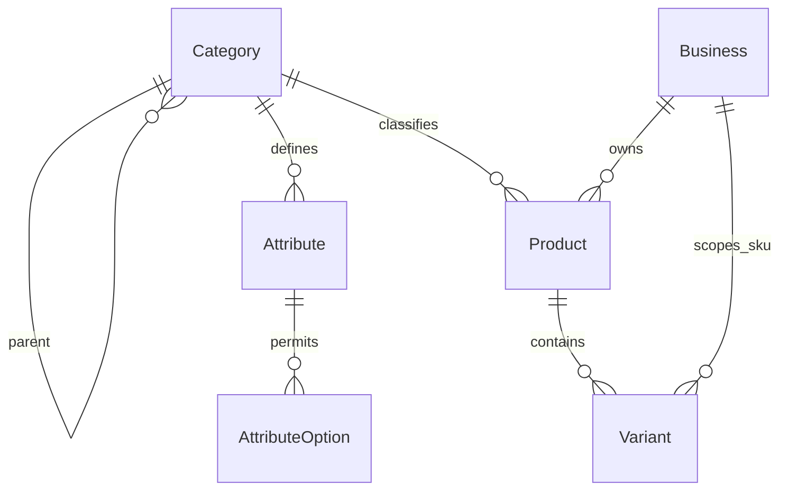
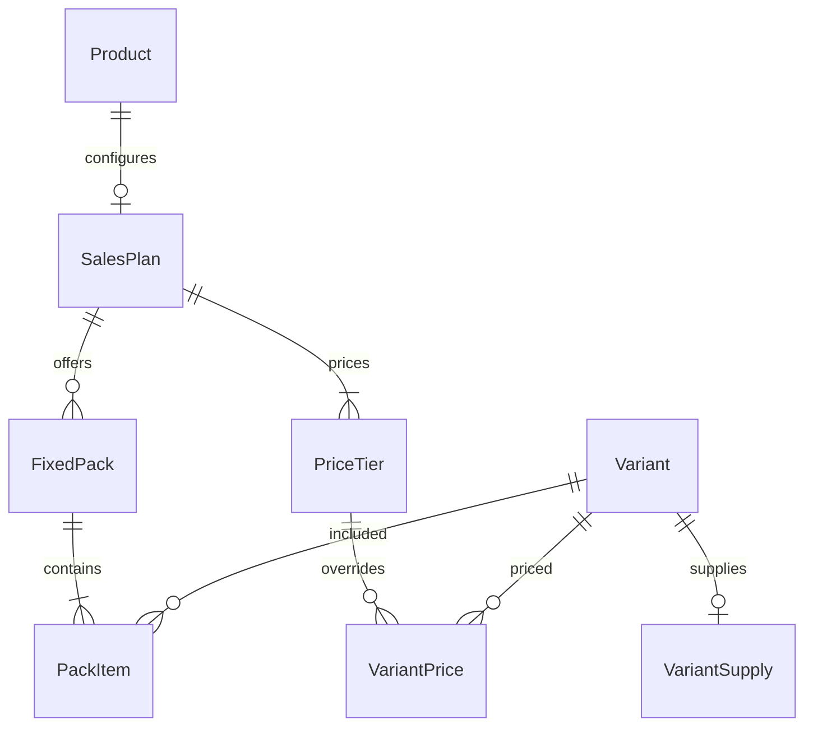
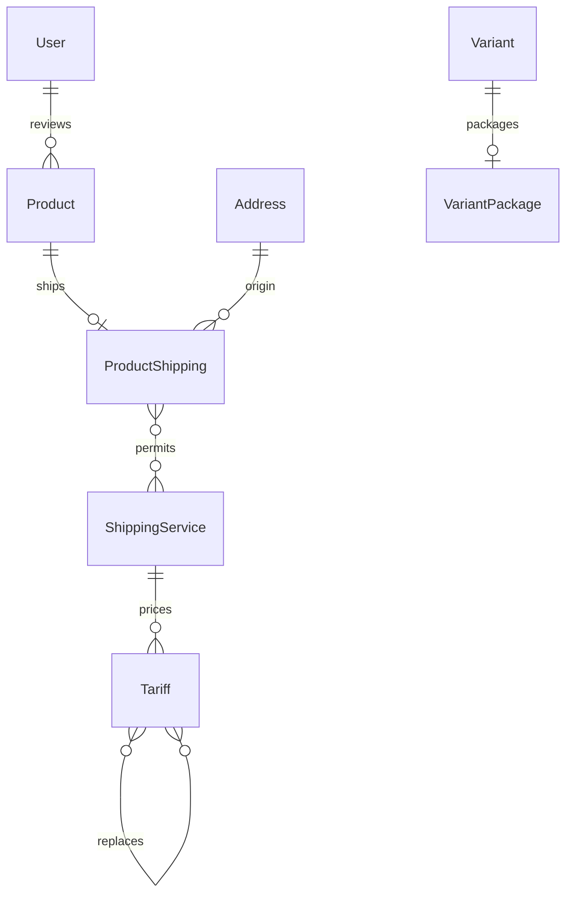
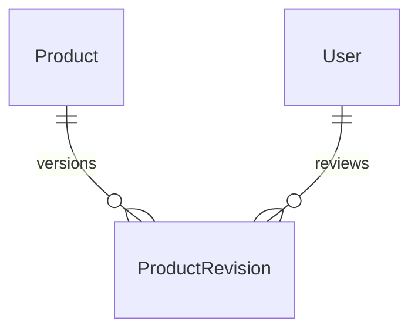
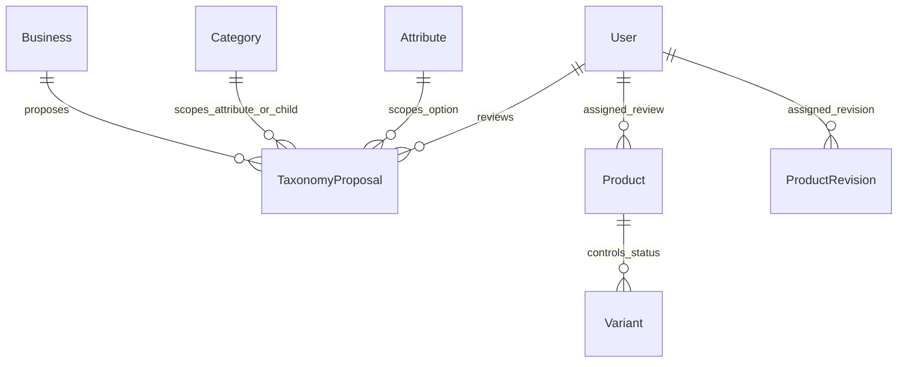

# ERD منطقی

UUID کلید اصلی مدل‌های دامنه است؛ ارتباط‌های این نمودار ownership را نشان می‌دهند. جدول‌های ماژول‌های تجاری هنوز migration ندارند.

```mermaid
erDiagram
    User ||--o| Membership : owns
    Business ||--|| Membership : has_owner
    User ||--o{ PlatformRole : has
    User ||--o{ AuthSession : opens
    User ||--o{ EmailChallenge : requests
    Business ||--o{ Address : has
    Business ||--o| VerificationApplication : submits
    Business ||--o{ BusinessRevision : revises
    VerificationApplication ||--|{ VerificationSection : contains
    VerificationSection ||--o{ Evidence : contains
    StoredFile ||--o{ Evidence : documents
    User ||--o{ StoredFile : uploads
    Business ||--o{ Product : produces
    Category ||--o{ Product : classifies
    Product ||--|{ ProductRevision : versions
    Product ||--|{ Variant : has
    Product ||--o{ PriceTier : prices
    Variant ||--|| Supply : offers
    Supply ||--o{ Reservation : reserves
    Business ||--o| Cart : shops
    Cart ||--o{ CartProductSelection : selects
    Business ||--o{ OrderGroup : places
    OrderGroup ||--|{ Order : groups
    Order ||--|{ OrderLine : snapshots
    OrderLine ||--o{ Reservation : allocates
    Order ||--o| Payment : pays
    Payment ||--|| Invoice : issues
    Invoice ||--o{ Adjustment : adjusts
    Order ||--o{ Refund : refunds
    Order ||--o| Settlement : settles
    Order ||--o{ SettlementHold : blocks
    ShippingService ||--o{ TariffVersion : rates
    TariffVersion ||--|{ TariffRow : contains
    Order ||--|{ ShippingGroup : ships
    ShippingGroup ||--o| TransportRequest : requests
    Carrier ||--o{ TransportRequest : assigned
    ShippingGroup ||--o{ Shipment : executes
    Shipment ||--|{ ShipmentItem : allocates
    OrderLine ||--o{ ShipmentItem : includes
    Shipment ||--o{ DeliveryChallenge : proves
    Order ||--o{ DiscrepancyCase : disputes
    DiscrepancyCase ||--|{ DiscrepancyLine : claims
    DiscrepancyLine ||--o{ Resolution : resolves
    Resolution ||--o{ Compensation : executes
    User ||--o{ Ticket : creates
    Ticket ||--o{ Message : contains
    Order ||--o{ Entitlement : grants
    Entitlement ||--o| Review : uses
    Review ||--o| Reply : answers
    Review ||--o{ ModerationAction : moderates
    User ||--o{ AuditEvent : acts
    User ||--o{ WorkItem : claims
    OutboxEvent ||--o| InboxNotification : delivers
```

FKها پیش‌فرض `PROTECT` برای سابقهٔ دامنه‌اند. حذف User/Business از API وجود ندارد. حذف session/OTP صرفاً طبق سیاست retention جداگانه و بدون حذف audit انجام می‌شود. مرجع عمومی audit/outbox از نوع `(aggregate_type, aggregate_id)` است و جای FK برای دادهٔ مالی را نمی‌گیرد.

Constraintهای دقیق و indexهای اولین migration در [فرهنگ داده](data-dictionary.md) تعریف شده‌اند. برای ماژول‌های بعدی، constraintهای جمع چند ردیف با lock aggregate و تست رقابت اعمال می‌شوند؛ `CHECK` عادی نمی‌تواند مجموع جدول دیگر را enforce کند.

## ERD اجرایی هستهٔ پیش‌نویس کاتالوگ — 2026-09-08

نمودار کلان بالاتر شامل ماژول‌های آینده است؛ روابط واقعاً ایجادشدهٔ این برش:

ویژگی‌ها JSON معتبرشده با code هستند؛ images آرایهٔ مرتب UUID فایل خصوصی‌اند و FK ندارند. سیاست اعتبارسنجی و محدودیت‌ها در data-dictionary و قرارداد catalog-drafts آمده‌اند. مدل‌های قیمت، عرضه و ProductRevision در بخش‌های بعد اضافه شده‌اند.

## ERD اجرایی فروش و عرضه — 2026-09-08

وجود حداقل روش فروش/پله و تعلق ارجاع‌ها به همان محصول در تراکنش service کنترل می‌شود. ProductRevision و سفارش هنوز مدل اجرایی ندارند.

## ERD اجرایی حمل و انتشار اولیه — 2026-09-09

ProductRevision و Shipment هنوز مدل اجرایی ندارند. دادهٔ وضعیت و آخرین تصمیم انتشار روی Product و تاریخچهٔ تصمیم‌ها در AuditEvent نگهداری می‌شود.

## بازنگری اجرایی محصول — 2026-09-09

ProductRevision اکنون migration اجرایی دارد؛ proposed به تنوع‌های موجود یا شناسهٔ پیش‌اختصاص‌یافتهٔ تنوع تازه اشاره می‌کند. ردیف تنوع تازه فقط هنگام پذیرش ساخته می‌شود. Variant بایگانی‌شده با is_active=false حفظ می‌شود.

## پیشنهاد taxonomy و عملیات تکمیلی کاتالوگ — 2026-09-10

TaxonomyProposal برای خروجی مصوب `result_id` polymorphic نگه می‌دارد و kind نوع Category/Attribute/AttributeOption را تعیین می‌کند. پیشنهاد pending مشابه قید یکتای شرطی دارد. منشأ و دلیل وضعیت مستقل روی Variant ثبت می‌شوند؛ تاریخچهٔ کامل transition و بازتخصیص در AuditEvent است.
