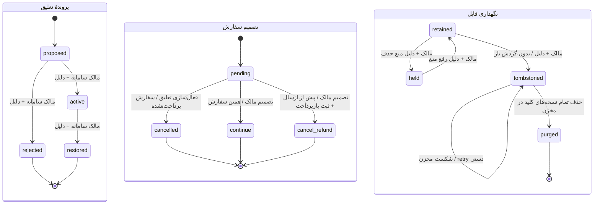
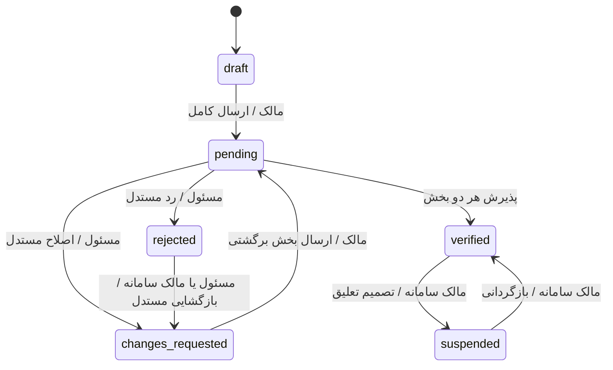

# چرخه‌های وضعیت

## اجرای عملیات و نگهداری فایل — PRD-08 و ADR-0006

proposed/active برای هر scope تعلیق یکتا هستند. لغو unpaid رزرو را آزاد می‌کند؛ paid/shipped توقف تسویه و تصمیم مستقل دارند؛ shipped از cancel_refund منع می‌شود. تصمیم نهایی immutable است و بازگردانی تعلیق آن را برنمی‌گرداند. مهلت‌های سفارش/پرداخت/مغایرت/نظر از PolicyVersion مؤثر هنگام ساخت deadline گرفته می‌شوند؛ اعداد ۲۴/۷۲/۱۴ در بخش‌های تاریخی زیر پیش‌فرض هستند، نه تنظیم ثابت. تیکت closed با فرمان اختصاصی مالک و دلیل می‌تواند به in_review برگردد.

حذف فایل بدون زمان‌بندی خودکار است. tombstone پیش از I/O مخزن commit می‌شود؛ در شکست، صدور URL جدید مسدود می‌ماند. اصل metadata برای روابط و audit حفظ می‌شود. [runbook](../backend/file-retention-runbook.md).

## اجرای مالی PRD-05

وضعیت مالی از FinancialEventها مشتق می‌شود: بدون payment→pending، payment→reserved، refund/adjustment→مبلغ خالص تازه، settlement→final. حالت پرداخت ناموفق و PATCH وضعیت مالی وجود ندارد. رویدادها و اسناد صادرشده ثابت‌اند؛ جبران رویداد تازه با سند شماره‌دار است.

`CancellationRequest.refund_pending → completed` و `Order.active → cancelled` همراه بازپرداخت کامل در یک transaction رخ می‌دهند. پس از تحویل و پایان مهلت یا بسته‌شدن تمام پرونده‌ها و تحویل اقلام باقی‌مانده، settlement یکتا طلب تولیدکننده و کارمزد نهایی را ثبت می‌کند. `orders/0006_order_completion` گذار active→completed و completed_at تغییرناپذیر را اضافه می‌کند؛ تکمیل و تسویه اتمیک‌اند. entitlement در PRD-07 به این زمان متصل می‌شود.

FinanceHold مرجع‌دار از باز به released_at می‌رود؛ مرجع بسته دوباره باز نمی‌شود. تعلیق مؤثر، پروندهٔ لجستیکی یا لغو باز و تصمیم مالی اعمال‌نشده نیز مانع تسویه هستند. [جزئیات](../api/finance.md).

## برش اجرایی سفارش PRD-04

`pending → accepted/rejected/expired/cancelled`؛ `accepted → active/expired/cancelled`؛ لغو پرداخت‌شدهٔ `active → cancelled` فقط پس از قرارداد مالی. deadline پاسخ از checkout و deadline پرداخت از پذیرش، هرکدام ۲۴ ساعت‌اند. تغییر snapshot و گذار غیرمجاز در PostgreSQL رد می‌شود. گذار active→completed با تسویهٔ PRD-05 و ثبت completed_at انجام می‌شود.

Reservation: `reserved → allocated/released` و `allocated → released` در لغو مالی مجاز؛ مقدار و تنوع ثابت و مجموع متعهدشده محدود به عرضه است. سبد بسته دوباره فعال نمی‌شود.

CancellationRequest: پیش از آماده‌سازی `refund_pending`؛ پس از آماده‌سازی `pending → refund_pending/referred`؛ رد یا انقضای ۲۴ساعته ارجاع می‌دهد. اپراتور `referred → refund_pending/denied` و callback مالی `refund_pending → completed` را انجام می‌دهد. درخواست نهایی و مرجع بازپرداخت تغییرناپذیرند. تحویل به حمل‌کننده لغو مستقیم را مسدود می‌کند. وضعیت درخواست مستقل از Order است؛ در refund_pending سفارش تا بازپرداخت فعال ولی عملیات آماده‌سازی/ارسال متوقف است.

تمام commandها باید actor، permission، وضعیت جاری و deadline را داخل transaction بازبینی کنند. تغییر وضعیت از PATCH عمومی یا Admin مجاز نیست. جدول زیر مبنای طراحی هر برش است؛ تست executable هر برش در ردیابی ثبت می‌شود.

## اعتماد کسب‌وکار — PRD-01

هر بخش `identity` و `activity` مستقل `draft → pending → approved|changes_requested|rejected` دارد. نتیجهٔ بخش approved هنگام اصلاح بخش دیگر ثابت است. در انتظار بررسی، مالک حق ویرایش ندارد. نخستین `verified_at` با تأیید مجدد تغییر نمی‌کند. deadline خودکار برای بررسی وجود ندارد. رد فعلی پایان submission است و بازگشایی استثنای صریح PRD-01/08 است. هر تصمیم، علت و before/after همراه outbox در همان commit ثبت می‌شوند.

## دیگر چرخه‌ها و guardها

بازنگری Business تأییدشده مستقل `pending → approved|changes_requested|rejected` است؛ مالک فقط بخش برگشتی را اصلاح و دوباره pending می‌کند. وضعیت live Business در همهٔ این مراحل verified می‌ماند. آخرین پذیرش، current profile/address/identity را در همان transaction جایگزین می‌کند؛ before/proposed نسخهٔ نهایی immutable است. claim/permission مانند پروندهٔ اولیه ولی مسئولیت مستقل دارد.

| چرخه / مرجع | گذار و actor | شرط و اثر | deadline / terminal |
|---|---|---|---|
| انتشار / PRD-02 | مالک draft→pending؛ مسئول pending→published/changes_requested/rejected | Business تأیید، ویژگی/قیمت/عرضه/حمل معتبر؛ نسخهٔ عمومی تنها مصوب | رد با دلیل؛ نسخهٔ منتشرشده تا پذیرش اصلاح حفظ می‌شود |
| سفارش / PRD-04 | checkout→awaiting_response؛ تولیدکننده→accepted/rejected؛ سیستم→expired | رزرو همراه checkout؛ رد و expiry رزرو را آزاد می‌کنند | پاسخ ۲۴ ساعت؛ rejected/expired terminal |
| سفارش / PRD-04/05 | accepted→active با Pay خرده‌فروش | قبل از payment_due_at؛ یک Payment و Invoice؛ رزرو→allocated | پرداخت ۲۴ ساعت پس از پذیرش |
| لغو / PRD-04 | پیش از پرداخت→cancelled؛ قبل از آماده‌سازی پس از پرداخت→cancelled+refund؛ بعد از آماده‌سازی→cancel_requested | پذیرش تولیدکننده جبران را آغاز؛ رد/timeout ارجاع اپراتور؛ بعد از ارسال ممنوع | پاسخ لغو ۲۴ ساعت؛ cancelled terminal |
| آماده‌سازی / PRD-03 | not_started→preparing→ready | فقط Order پرداخت‌شده؛ همهٔ تعداد گروه آماده | deadline از snapshot تولید؛ بدون مبلغ جدید |
| درخواست حمل / PRD-03 | waiting_ready→ready_to_assign→assigned→completed/cancelled | آمادگی همهٔ اقلام؛ تخصیص توسط مسئول به حمل‌کنندهٔ فعال؛ وزن نامنطبق مانع تخصیص | completed/cancelled terminal |
| مرسوله / PRD-03 | created→handed_over→in_transit→delivered یا unconfirmed→delivered/failed | شمارش دقیق هنگام handover قفل؛ بدون کد فقط تصمیم مستند مسئول | delivered/returned/cancelled terminal؛ ارسال مجدد رکورد تازه |
| کد تحویل / PRD-03 | issued→consumed/expired/revoked | شش رقم، hash؛ صدور تازه قبلی را باطل؛ فقط همان مرسوله | ۱۰ دقیقه، ۵ تلاش، فاصله ۶۰ ثانیه، ۵ صدور در ساعت؛ لینک مأمور ۲۴ ساعت |
| تحویل Order / PRD-03/04 | partially_shipped→shipped→partially_delivered→delivered | فقط تحویل آخرین تعداد؛ failure→needs_attention و منع آغاز مهلت | discrepancy_due_at یک‌بار برابر تحویل کامل +۷۲ ساعت |
| مالی / PRD-05 | awaiting_payment→paid→partially_refunded/fully_refunded؛ paid/partially_refunded→awaiting_settlement→settled | جبران فقط علت معتبر؛ hold مانع تسویه؛ مبلغ از snapshot | paid یک‌بار؛ سند مالی صادرشده تغییرناپذیر |
| مغایرت / PRD-06 | open→awaiting_response→accepted/escalated→compensating→closed | ادعا داخل ۷۲ ساعت با مدرک و تعداد؛ رد یا بی‌پاسخی فقط unresolved را ارجاع می‌دهد | پاسخ ۴۸ ساعت؛ بسته پس از اجرای واقعیِ جبران داخلی |
| تکمیل / PRD-04..07 | active→completed | تحویل کامل، پایان مهلت، هیچ مغایرت باز؛ بررسی hold پیش از settlement | entitlement و تسویه idempotent |
| Ticket / PRD-06 | new→in_review→waiting_user/resolved→closed؛ پاسخ به resolved→in_review | فقط طرف مرتبط/مسئول؛ پیام مالی را تغییر نمی‌دهد | closed terminal؛ بستن خودکار ندارد |
| تعلیق / PRD-01/08 | active→suspended→active توسط مالک سامانه | علت، مدرک و تعیین تکلیف هر Order؛ User و Business مستقل | بدون انقضای خودکار؛ بازگردانی رکوردهای لغوشده را باز نمی‌کند |
| Review / PRD-07 | draft→submitted→published؛ حق استفاده‌نشده→expired | ارسال قفل؛ همکاری با ثبت دو طرف یا پایان مهلت هم‌زمان؛ محصول مستقل | ۱۴ روز از completion؛ moderation متن با invalidation امتیاز فرق دارد |
| صف / PRD-08 | unassigned→claimed→closed؛ owner reassign | lock ردیف؛ فقط مسئول/مالک command؛ غیرفعال‌سازی اپراتور کار باز را آزاد می‌کند | بدون claim lease خودکار |
| نشست / ADR-0005 | active→rotated یا revoked/expired | فقط refresh جاری؛ reuse خانواده را باطل؛ خروج access همان خانواده را هم قطع می‌کند | access ۵ دقیقه؛ session حداکثر ۷ روز |

برای پیاده‌سازی هر ماژول، نام enum دقیق و transitionهای تفصیلی باید با سند اختصاصی همان PRD تطبیق داده شوند؛ این خلاصه جای تست معیارهای پذیرش آن ماژول نیست.

## وضعیت‌های اجرایی PRD-03 — 2026-09-10

نام‌های جدول طراحی بالا در کد به این شکل تثبیت شده‌اند:

- ShippingRequest: `waiting → ready/spec_review → assigned → in_transit → completed`؛ اختلاف مشخصات، شکست یا توقف دستی به `attention` و نتیجهٔ لغو به `cancelled` می‌رود. دو وضعیت آخر completed/cancelled نهایی‌اند. ارسال مجدد به تخصیص و بازهٔ جمع‌آوری تازه نیاز دارد.
- Shipment: `ready → handed_over → in_transit`؛ از handed_over/in_transit به delivered با کد، unconfirmed با ادعا یا failed با شکست؛ unconfirmed فقط با مدرک/تصمیم اپراتور به delivered/failed، failed فقط به returned. لغو تنها از ready. delivered/returned/cancelled نهایی‌اند.
- Order fulfillment: وضعیت کلی از تعداد اقلام مشتق می‌شود؛ `no_shipments/partially_shipped/fully_shipped/partially_delivered/attention/fully_delivered`. پس از نتیجهٔ مالی ارجاع لغو، اقلام تحویل‌شده حفظ می‌شوند و سفارش فاقد تحویل کامل، fully_delivered نمی‌شود.
- DeliveryLink: معتبر تا ۲۴ ساعت؛ بازصدور یا revoked_at یا وضعیت استثنایی/نهایی مرسوله اعتبار را پایان می‌دهد. DeliveryChallenge: ۱۰ دقیقه، پنج تلاش، فاصلهٔ صدور ۶۰ ثانیه و پنج صدور در ساعت؛ صدور تازه قبلی را مصرف/باطل می‌کند.

قفل Order باعث می‌شود تحویل هم‌زمان آخرین مرسوله‌ها فقط یک `delivered_at`، یک `discrepancy_deadline` و یک اعلان بسازد. گذارها و وضعیت نهایی در PostgreSQL نیز محافظت شده‌اند. [جزئیات API و قرارداد لغو/مالی](../api/fulfillment.md).

## وضعیت اجرایی PRD-06

پرونده فیلد status مستقل ندارد؛ باز/بسته از closed_at و وضعیت هر ردیف از تصمیم‌ها، referred_at و جبران استخراج می‌شود. پذیرش تولیدکننده نهایی است؛ رد او تا تصمیم اپراتور حل‌نشده می‌ماند. پاسخ هر ردیف deadline جدا دارد. بستن پیش از پایان ۷۲ ساعت یا با مقدار بی‌تصمیم/جبران باز رد می‌شود.

مرسولهٔ جبرانی: ready → handed_over → in_transit → delivered؛ handed_over → delivered نیز مجاز است. فقط ready می‌تواند با منتفی‌شدن مستدل جبران cancelled شود. delivered جایگزینی، جبران را کامل می‌کند؛ delivered مرجوعی، بازپرداخت داخلی PRD-05 را اجرا می‌کند. مرسوله‌های purpose≠order در محاسبهٔ تحویل سفارش و آغاز deadline دخالت ندارند.

تیکت ارجاعی تا بسته‌شدن پرونده closed نمی‌شود؛ resolved آن با پیام کاربر یا ارجاع تازه به in_review بازمی‌گردد. بستن پرونده تیکت را خودکار نمی‌بندد.

## اجرای PRD-07

- Entitlement: available→submitted یا available/draft→expired؛ مهلت دقیق از completed_at و تنظیم REVIEW_WINDOW_DAYS ثبت می‌شود. برای یک Order همهٔ موضوع‌ها deadline یکسان دارند. submitted منقضی نمی‌شود.
- Review: draft→submitted؛ محصول در همان لحظه published، همکاری در ارسال دوم یا deadline با یک timestamp مشترک published می‌شود. پس از submitted محتوا تغییرناپذیر و published برگشت‌ناپذیر است؛ حذف مجاز نیست.
- content_hidden و invalidated دو محور مستقل‌اند؛ hide/unhide متن/تصویر را کنترل می‌کند، invalidate/revalidate کل نمایش و سهم aggregate را. هیچ‌کدام state مالی یا Order را تغییر نمی‌دهد.
- Reply: draft→submitted؛ فقط Business دریافت‌کننده و فقط برای نظر منتشرشدهٔ معتبر. پاسخ نهایی تغییرناپذیر، گزارش‌پذیر و صرفاً مشمول hide/unhide محتواست.
- Report: باز→resolved با hide/unhide/invalidate/revalidate/dismiss مستدل. اقدام بعدی برای بازگردانی از همان Report امکان‌پذیر است؛ هر اقدام before/after و کلید idempotency دارد، متن اولیهٔ گزارش حفظ می‌شود.
